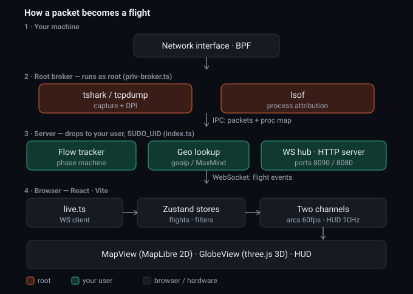

# Netport-Radar architecture

Netport-Radar is a read-only local network monitor: every connection is drawn as
a flight on a great-circle arc. The capture path never injects, blocks or
modifies traffic. The security model and threat model are in the
[README](README.md#security-and-infrastructure-design); this document covers how
the pieces fit together.



## Contents

- [Data flow](#data-flow)
- [Ownership split](#ownership-split)
- [Server](#server-server)
- [Privilege separation](#privilege-separation)
- [Frontend](#frontend-src)
- [Process attribution](#process-attribution)
- [IPv4/IPv6 merging](#ipv4ipv6-merging)
- [Replay and diagnostics](#replay-and-diagnostics)
- [Conventions](#conventions)

## Data flow

```
 root                          your user                         browser
┌──────────────────────┐      ┌──────────────────────────┐      ┌───────────────────────────┐
│ priv-broker.ts       │ pcap │ tshark -i -  (dissect)   │      │ live.ts / live-state.ts   │
│  dumpcap -w -        │─────►│   │ one line per packet  │      │  init snapshot + patches  │
│  (or tcpdump -Z)     │ unix │   ▼                      │  WS  │  animates arcProgress     │
│                      │ sock │ FlowTracker              │:8090 │   │                       │
│  lsof poller ────────┼─IPC─►│  flows, phases, metrics  │─────►│   ▼                       │
└──────────────────────┘      │   │ FlightEvent          │ JSON │ Zustand stores            │
                              │   ▼                      │/100ms│ MapView (MapLibre)        │
                              │ WsHub ── logger (memory) │      │ GlobeView (three.js)      │
                              │ static server :8080      │      │ boards, card, HUD         │
                              └──────────────────────────┘      └───────────────────────────┘
```

Without sudo there is no broker: `tshark` (or `tcpdump`) captures and dissects in
one process and `lsof` runs inline.

## Ownership split

- The server owns the facts: flow phase (`taxi → cruise → hold → descent →
  landed`), byte counters, process attribution, hostname and SNI.
- The client owns animation. `arcProgress`, the position along the arc, is
  computed every frame from the phase and the time spent in it. The server never
  sends positions.
- `init` carries a snapshot of every open flight, and the client rebuilds its
  list from it on every (re)connect. After that, changes arrive as patch events
  (`updated` with only the changed fields), batched every 100 ms.

## Server (`server/`)

| File | Role |
| --- | --- |
| `index.ts` | Entry point: preflight, inline vs brokered capture, control messages, shutdown |
| `config.ts` | Ports, bind host, token, timing constants |
| `capture.ts` | Backend detection, raw capture and decoder processes, line parsers, GeoIP, reverse-DNS cache |
| `capture-supervisor.ts` | Keeps one capture process alive: restart once, declare dead after a second death within 30 s, stop on permission errors |
| `priv-broker.ts` | Root broker: raw capture, `lsof`, pcap stream to the parent |
| `pcap-socket.ts` | Parent side of the pcap stream: Unix socket listener with the nonce check |
| `privdrop.ts` | Drop target from `SUDO_UID`/`SUDO_GID`, `setgid`/`setgroups`/`setuid`, fail-closed check |
| `home.ts` | Public-IP geolocation for the home airport |
| `flow-tracker.ts` | Packets to flows (hostname and /64 merging keys), phase machine, metrics, classification, snapshot |
| `process-names.ts` | `lsof -i -nP +c0 -FpcPn` polling, `proto:port` to process and PID |
| `ws.ts` | WsHub: batching, init and error replay, origin/token gate, inbound validation |
| `static.ts` | Static file server for `dist/`, confined to that directory |
| `logger.ts` | In-memory NDJSON session log (capped at 200k lines) |

The phase machine: a new 5-tuple starts in `taxi` and waits up to 2 s for DNS,
then emits `opened`. Data moves it to `cruise`; more than 5 s idle moves it to
`hold`, and new data back to `cruise`. FIN or RST starts a 2 s `descent`, then
`landed`, and the server drops the flow 30 s later (the client keeps it about
60 s for the fade). A flow with no packets for 120 s is closed.

## Privilege separation

When started through sudo on macOS or Linux, `index.ts` does the following while
it is still root:

1. Creates a `0700` directory, hands it to the invoking user, and listens on a
   Unix socket inside it.
2. Forks the broker and sends it `init` (backend, interface, socket path, a
   random nonce).
3. Drops to `SUDO_UID`/`SUDO_GID` and exits if that fails or leaves it at uid 0.

For each capture instance the broker starts `dumpcap -w -` (or `tcpdump -Z
<user>`), connects to the socket, writes the nonce line and pipes the capture
output after it. The parent checks the nonce and feeds the stream to `tshark -i -`
running as the user. (`-i -` rather than `-r -`, because tshark refuses to read a
socket as a file.) macOS libpcap can't read pcap from a pipe, so the tcpdump
backend uses `-Z` to drop privileges inside tcpdump instead, and its text output
is parsed directly.

After the drop, the broker treats the parent as untrusted: `init` is accepted
once, the `-Z` user comes from the broker's own environment, and every interface
name is checked. The broker exits when the IPC channel closes, so it never
outlives the server. An interface switch restarts the capture in the broker,
which opens a new socket connection, and the parent swaps decoders.

## Frontend (`src/`)

**Stores (Zustand).** `flights` (list, selection, homes), `filters` (protocol
families, LAN/IPv6, DNS density, direction, search, country isolation, view and
theme, persisted to sessionStorage), `backend`, `connection`, `toasts` and
`diagnostics`.

**Live client.** `lib/live-state.ts` holds the flight list and applies server
messages, validating each one first (`parseServerMessage`, `isFlight`, patches
limited to existing fields). `lib/live.ts` owns the socket, the reconnect logic
(each handler checks that it still owns the current socket) and the rAF loop that
animates progress and pushes to the store at 10 Hz.

**Render queue** (`lib/render-queue.ts`). At most 150 flights plus 20 DNS drones.
When full, landed flights go first, then hold, then taxi; cruise and descent
are never dropped. Components subscribe only to the filter fields that affect
the queue, and the memo compares them by value.

**Views.**
- **Shared position math.** `lib/flight-pos.ts` (`flightWorldPos`) is the one
  place that computes where a plane is (LAN pinning, lifecycle pose, arc
  altitude). The 2D markers, 3D meshes, 3D hit-testing, flight card and leader
  line all use it.
- **`MapView`** runs two cadences. Marker positions update every other frame
  with cached elements and change-detected style writes. Trails, routes,
  destinations and chip placement rebuild at about 10 Hz. Marker DOM is in
  `lib/map-markers.ts`, layers in `lib/map-layers.ts`, theme paint in
  `lib/map-theme.ts`, and chip collision culling in `lib/chip-layout.ts`.
- **`GlobeView`** is lazy-loaded. It draws low-poly aircraft meshes with shared
  geometry and material caches (`lib/globe-meshes.ts`), strobes, a far-zoom LOD
  and projection-based click selection. On unmount it releases the WebGL
  context.

**Theming** (`lib/themes.ts`, seven themes). The 2D map recolors the CARTO
dark-matter style per layer type, or switches to Positron or Esri imagery. The
globe uses the same palette: a fragment shader in `lib/globe-material.ts` maps the
earth texture's luminance bands to the theme's land and water colors.

**Demo mode.** `VITE_DEMO=1` swaps the live client for `lib/demo.ts`, which
simulates flights to fixed, plausible locations per host.

**Accessibility.** `SceneAnnouncer` provides an off-screen description and a
live region for the selected flight; the boards are listboxes; `[` and `]` step
through flights; `prefers-reduced-motion` turns off orbits and flares.

## Process attribution

`process-names.ts` polls `lsof` keyed on `proto:localPort`. The interval is 2 s
when idle. When the flow tracker sees a young unattributed flow, it signals a
miss (sent to the broker as a `boost` message in brokered runs), which triggers
an immediate poll and a 1 s interval for about 6 s. Rows for closed sockets are
kept for 3 s so very short flows can still be attributed, and then expire. Late
attribution emits `updated`, and both views recolor the plane.

## IPv4/IPv6 merging

Once a hostname is known (SNI or reverse DNS), the flow key becomes
`localIp>host:hostname:port:proto`, so IPv4 and IPv6 flows to the same host become
one flight. Late resolution re-keys the flow and absorbs the duplicate, adding
up the byte counters. Hostless IPv6 flows merge within their `/64`. Until a
hostname resolves, a v4 and v6 pair shows as two flights.

## Replay and diagnostics

`npm run replay -- session.ndjson --speed 10` (`server/scripts/replay.ts`)
replays recorded `FlightEvent`s over WebSocket without capturing. In the
browser, `store/diagnostics.ts` records WebSocket close codes and lazy-chunk
failures, shown as hints in the top bar; the stethoscope button exports them as
JSON.

## Conventions

- `npm run check` (both tsconfigs, ESLint, vitest) is the gate, enforced in CI
  together with a runtime-dependency `npm audit`.
- TypeScript is strict everywhere. `src/types.ts` is the protocol definition
  shared by server and client.
- Frontend imports use the `@/` alias; the server imports `../src/` relatively.
- Pure logic lives in `src/lib` and `server/` modules with unit tests in
  `tests/`; component tests run on happy-dom.
