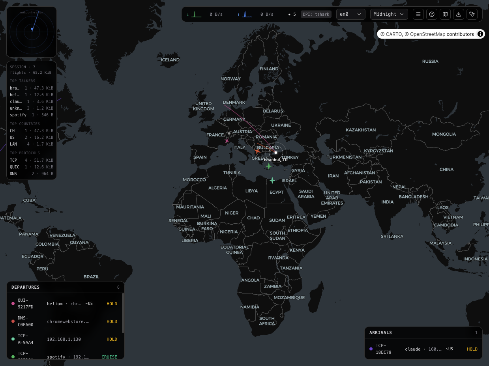
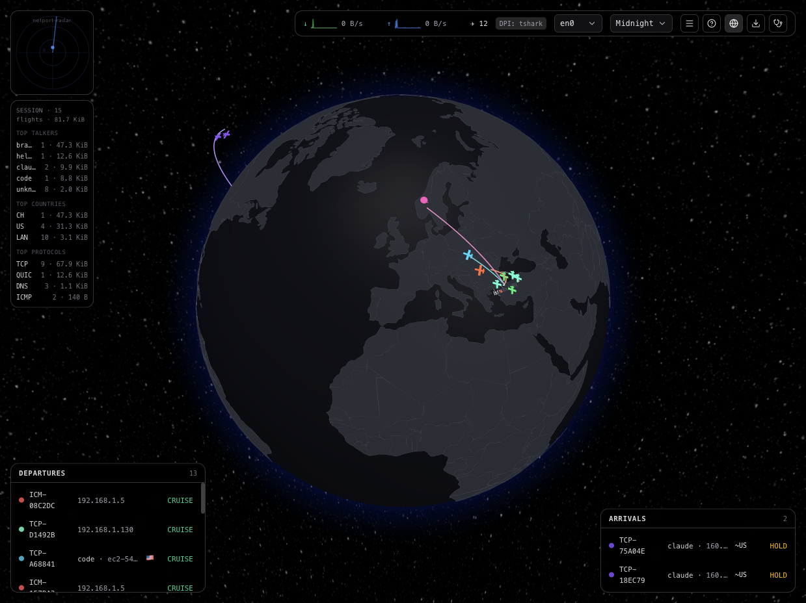
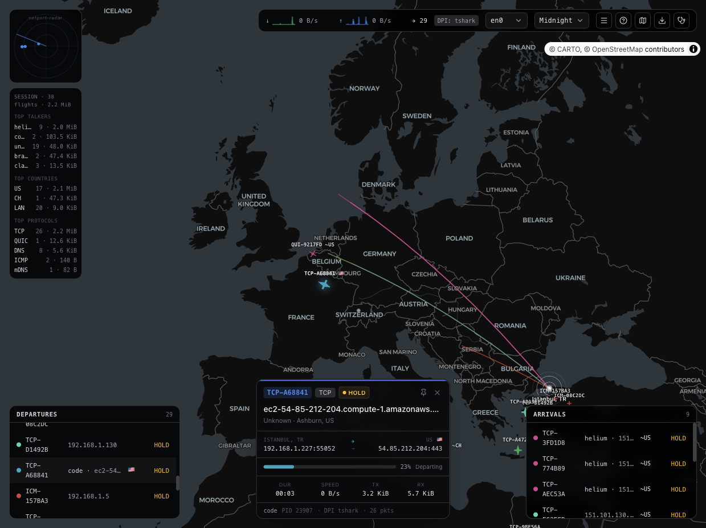
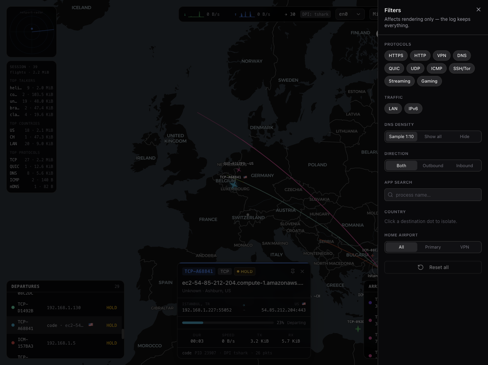

# netport-radar

Visualization-only local network monitor. Your machine is an airport; every
connection is a flight flying an animated great-circle arc on a dark world map
(or 3D globe) toward the remote IP's country.

**Read-only by design** — no blocking, no firewall, no traffic modification.
Capture and deep-packet inspection run entirely on your machine. Seven color
themes recolor the whole scene (2D map *and* 3D globe), and the UI is keyboard-
and screen-reader-navigable.

## Screenshots

| 2D map (Midnight) | 3D globe |
| --- | --- |
|  |  |

| Flight card | Filters |
| --- | --- |
|  |  |

## Stack

Vite · React · TypeScript (strict) · Tailwind v4 · shadcn/ui · Zustand ·
MapLibre GL (2D) · react-globe.gl + three (3D, lazy-loaded) · ws · geoip-lite.

The backend is a small Node capture service; the frontend is a single-page app
served over HTTP. See [ARCHITECTURE.md](ARCHITECTURE.md) for the data flow and
ownership model.

## Quick start

```bash
npm install
sudo npm start          # build UI + start capture, opens http://localhost:8080
```

`npm start` builds the frontend, starts the Node capture backend (tshark →
tcpdump fallback), serves the UI on `:8080`, and streams flights over ws `:8090`.
Raw packet capture needs elevated permission — see [Platform setup](#platform-setup)
for the per-OS details and how to run without `sudo`.

## Platform setup

The backend prefers **tshark** (from Wireshark; full deep-packet inspection for
SNI/hostnames) and falls back to **tcpdump** (port-based protocol guessing). The
metrics strip's `DPI:` indicator shows which is active.

> tcpdump-only platforms get port-based protocol detection (no SNI/hostnames).
> Install Wireshark/tshark for the full DPI view.

### macOS

```bash
brew install --cask wireshark      # provides tshark
sudo npm start                     # capture needs root (BPF devices)
```

To capture **without** `sudo`, install Wireshark's **ChmodBPF** helper (Wireshark
→ *Install ChmodBPF* on first launch, or the bundled installer). It grants your
user access to the `/dev/bpf*` devices; then `npm start` works unprivileged.

### Linux

```bash
sudo apt install tshark            # or: dnf install wireshark-cli
sudo npm start
```

To capture **without** `sudo`, grant the capture capabilities to the binaries:

```bash
sudo setcap cap_net_raw,cap_net_admin=eip "$(command -v dumpcap)"
sudo setcap cap_net_raw,cap_net_admin=eip "$(command -v tcpdump)"
```

(`dumpcap` is the privileged helper tshark spawns.) Then run `npm start` as your
normal user.

### Windows

1. Install **Wireshark**, and during setup install **Npcap** (check *"WinPcap API
   compatible"*).
2. Run from an **Administrator** terminal (Npcap raw capture requires admin):

   ```powershell
   npm start
   ```

## Run modes

| Mode | Command | What it does |
| --- | --- | --- |
| **Live** | `sudo npm start` | Build + capture + serve UI on `:8080` |
| **Dev** | `npm run dev` + `sudo npm run server` | Vite UI on `:5173`, capture backend + ws on `:8090` |
| **Demo** | `VITE_DEMO=1 npm run dev` | Simulated data, no backend or capture |
| **Replay** | `npm run replay -- session.ndjson` | Feed an exported NDJSON session over WS |

### Replay (load testing without capture)

Replay an exported NDJSON session over WebSocket — useful for burst/GPU
profiling without live traffic or `sudo`:

```bash
# Terminal 1 — stop any live server on :8090 first
npm run replay -- path/to/session.ndjson --speed 10

# Terminal 2
npm run dev
```

Options: `--speed N` (default 1), `--loop`, `--port 8090`. Accepts server NDJSON
exports (from the metrics strip **Export log**) and client-side flight snapshots.
Toggle the dev FPS overlay with `F` (or `VITE_FPS=1 npm run dev`).

## Configuration

### Home location

Behind NAT your source IP is private and can't be geolocated, so the home airport
is placed from your **public IP** — one lookup per session (HTTPS-first: `ipapi.co`,
falling back to `ip-api.com`, then `ipify` + the local GeoIP database). That's the
only outbound request the app makes. To skip it and set your location manually:

```bash
sudo NETPORT_HOME_LAT=41.01 NETPORT_HOME_LNG=28.97 NETPORT_HOME_LABEL="Istanbul, TR" npm start
```

### Better geo (optional)

By default, destination countries come from the bundled GeoLite2 database
(country-accurate, no ASN/org). For **city-accurate destinations + real ASN/org**
on the flight card, point the app at MaxMind GeoLite2 `.mmdb` files (free account,
you download them — nothing is bundled):

```bash
sudo NETPORT_MMDB_CITY=~/GeoLite2-City.mmdb \
     NETPORT_MMDB_ASN=~/GeoLite2-ASN.mmdb npm start
```

If a file is missing or unreadable, it silently falls back to the bundled DB.
City-level placement shows the country flag; country-only guesses show `~CC` on
the map and boards. Unknown destinations land on the `??` mid-Atlantic shelf.

### Remote viewing

`NETPORT_BIND=0.0.0.0 sudo npm start` exposes the dashboard on your LAN and prints
a tokenized URL (`http://<your-ip>:8080/?token=…`). Every WS connection must then
present that per-boot token. See [Security model](#security-model).

## Usage

### Controls

- **Click** a plane or a departures/arrivals row → flight card
- **`[` / `]`** step backward / forward through the on-screen flights · **Esc** clears the selection
- **[≡]** filters · **[⊞]** 2D / 3D · **theme** dropdown · **pin** = flight-card anchor ↔ dock · **[?]** legend
- (demo only) **R** reconnect overlay · **B** burst ~200 flights

### Themes

Pick from the theme dropdown in the top-right strip (persists across reloads):

| Theme | 2D map | 3D globe |
| --- | --- | --- |
| **Midnight** | native Carto dark-matter | matching dark vector globe |
| **Matrix / Cyberpunk / Amber / Blueprint** | dark-matter genuinely recolored (background/water/land/lines/labels via paint overrides) | flat themed ocean + country land polygons + border lines |
| **Arctic** | light Positron basemap | light vector globe |
| **Satellite** | real Esri World Imagery | realistic NASA blue-marble earth |

The 2D map is restyled at the MapLibre paint level (not a CSS tint); the 3D globe
is the vector analogue (country polygons) for themed maps and a real photo for
Satellite. Plane liveries keep their per-app brand colors in every theme.

### Accessibility

The map/globe is a `<canvas>` (opaque to assistive tech), so the data is also
reachable without it: an off-screen scene description + a polite live region
announce the selected flight; the Departures/Arrivals lists are `listbox`es with
spoken per-row labels and arrow-key navigation; `[` / `]` step through flights
globally; icon controls are labelled; and `prefers-reduced-motion` is honored.

## Security model

This tool watches your traffic, so its own surface is kept deliberately small
(full details in [ARCHITECTURE.md](ARCHITECTURE.md)):

- The capture server (ws `:8090`) and UI server (`:8080`) bind **127.0.0.1 only** —
  nothing on your network can reach them.
- WebSocket connections from web pages are allowed only from **localhost origins**,
  so a random website open in your browser can't read your traffic feed (browsers
  don't apply CORS to WebSockets — this gate matters).
- Remote viewing (`NETPORT_BIND=0.0.0.0`) requires a **per-boot token** on every
  WS connection.
- **Read-only by construction**: the capture path never blocks, injects, or
  modifies traffic. Everything stays on your machine except the single
  geolocation lookup above.

### Privilege separation

When started via `sudo` on macOS/Linux, the root-only work (spawning
`tshark`/`tcpdump` + polling `lsof`) runs in a small **broker child**, while the
main process — the network-facing WS + HTTP servers and the flow tracker —
**drops to your user** (`SUDO_UID`/`SUDO_GID`) right after. A boot self-check
asserts `process.getuid()` and emits a warning (WS `still_root` error) if the drop
failed. Set `NETPORT_NO_PRIVDROP=1` to keep the single-root-process behavior.

Capture runs **inline** (one process) without sudo (ChmodBPF / `setcap`) or on
Windows admin, and **brokered** on `sudo npm start` (macOS/Linux).

## Troubleshooting

The UI surfaces capture problems directly:

| Symptom | Meaning | Fix |
| --- | --- | --- |
| Blocking "No capture backend found" | neither tshark nor tcpdump is installed | install Wireshark (see [Platform setup](#platform-setup)) |
| Blocking "Port 8090 is already in use" | another netport-radar (or process) holds the ws port | `lsof -ti tcp:8090 \| xargs kill`, then restart |
| Amber "No capture permission" banner | the ws is up but capture can't read packets | run with `sudo`, or set up ChmodBPF / `setcap` |
| "Reconnecting…" overlay | the ws connection to the backend dropped | the client auto-retries every 3s; check the server is running |
| Transient warning toast | a mid-session capture hiccup (e.g. interface went down) | usually self-recovers; switch interface from the metrics strip if not |
| Amber diagnostics hint (metrics strip) | WebSocket disconnect or lazy-chunk load failure | check server is running; use **Export diagnostics** (stethoscope icon) for details |

## Known limitations

**Process attribution.** Process names come from `lsof -i -nP` polled every **2
seconds**, keyed on `proto:localPort` only:

- Short-lived connections that close before the next poll stay `process: '—'`.
- UDP ephemeral port reuse can mis-attribute a flow to the wrong app.
- Without sudo, `lsof` only sees the current user's sockets.

Late resolution triggers an `updated` patch and recolors 2D markers + 3D meshes.

**IPv6 flow merge.** Flows are keyed by literal 5-tuple
(`localIp:localPort>remoteIp:remotePort:proto`). The same logical connection over
IPv4 and IPv6 appears as **two separate flights** today — merge by hostname or
`/64` is planned, not yet shipped.

**App liveries.** Per-app brand colors live in `src/lib/livery.ts` (`BRAND_COLORS`
+ regex `ALIASES`). Known apps get official hex; everything else hashes to a
deterministic HSL, and system processes render muted gray.

## Testing

```bash
npm run check          # tsc (app + server) + eslint + vitest
npm test               # vitest only
npx vitest run --coverage
```

- **Unit / component tests** — `tests/*.ts` and `tests/*.test.tsx` (vitest +
  happy-dom). Pure logic: flow tracker, render queue, livery, themes, geometry.
- **Browser / visual checks** — use Cursor's built-in browser or Playwright MCP
  against `npm run dev` / `VITE_DEMO=1 npm run dev` (not bundled in this repo).
- **Load / replay** — `npm run replay -- session.ndjson --speed 10` feeds NDJSON
  into the WS client; combine with the dev FPS overlay (`F` or `VITE_FPS=1`).

`npm run check` is the quality gate (tsc ×2 + eslint + vitest, 148 tests),
enforced by GitHub Actions ([.github/workflows/ci.yml](.github/workflows/ci.yml)).

## Credits & data licenses

- Basemap tiles & style © [CARTO](https://carto.com/attributions), data
  © [OpenStreetMap](https://www.openstreetmap.org/copyright) contributors
- This product includes GeoLite2 data created by MaxMind
  (via [geoip-lite](https://github.com/geoip-lite/node-geoip))
- Globe textures from [three-globe](https://github.com/vasturiano/three-globe)
  (MIT; NASA visible-earth imagery), vendored in `public/textures/`
- Country shapes for the themed vector globe from
  [Natural Earth](https://www.naturalearthdata.com/) (public domain; 110m
  admin-0, slimmed), vendored in `public/geo/`
- UI pieces: [shadcn/ui](https://ui.shadcn.com) · [lucide](https://lucide.dev)
  icons · [MapLibre GL JS](https://maplibre.org) ·
  [react-globe.gl](https://github.com/vasturiano/react-globe.gl)

Licensed MIT — see [LICENSE](LICENSE).
