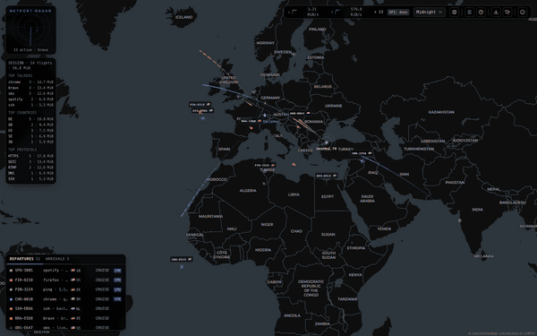
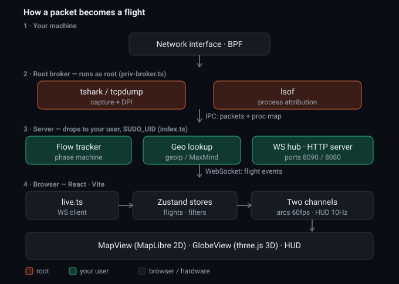

# netport-radar

A read-only network monitor that draws every connection on your machine as a
flight: each TCP/UDP/ICMP flow takes off from your computer toward the remote
IP's country, on a 2D map or a 3D globe. Capture and deep packet inspection run
locally and never block, inject or modify traffic.

Capture needs root. The parts that face the network (the WebSocket and HTTP
servers, the protocol dissectors) don't, and this project is built around
keeping them apart.



| 2D map | 3D globe |
| --- | --- |
|  |  |

| Flight card | Filters |
| --- | --- |
|  |  |

## Security design

### Threat model

The tool sees every host you talk to and parses traffic other people control.
It treats three things as hostile:

- Packets on the wire. Protocol dissectors have a long CVE history, so they never
  run as root.
- Local processes and web pages. Any local process can open the loopback
  WebSocket, and a website in your browser can try to as well (browsers don't
  apply CORS to WebSockets).
- Your LAN, if you turn on remote viewing.

### Privilege separation

`sudo npm run serve` forks a root broker, then drops the main process to your
user (`SUDO_UID`/`SUDO_GID`):

| Process | Runs as | Does |
| --- | --- | --- |
| broker | root | opens the capture device, polls `lsof` |
| `dumpcap` | root | writes raw pcap, parses nothing |
| `tshark -i -` | you | all protocol dissection |
| server | you | WebSocket and HTTP servers, flow tracker |

With the tcpdump backend, `tcpdump -Z <you>` opens the device as root and drops
to your user before it parses anything.



- The pcap stream goes over a Unix socket in a fresh `0700` directory, and each
  connection must open with a per-boot nonce, so other local processes can't
  inject traffic.
- Once the parent has dropped privileges, the broker treats its messages as
  untrusted: `init` is accepted once, the `-Z` user comes from the broker's own
  `SUDO_USER`, and interface names are validated.
- The drop fails closed: if `setuid` fails or the process is still uid 0, the
  server exits.
- Without sudo (ChmodBPF on macOS, `setcap` on Linux) everything runs in one
  unprivileged process.

### Network exposure

- Both servers bind `127.0.0.1`. The WebSocket accepts only localhost browser
  origins, so a website you visit can't read the feed.
- `NETPORT_BIND=0.0.0.0` opens the dashboard to your LAN and requires a per-boot
  token on every WebSocket connection.
- Inbound frames are capped at 4 KB and must match one of two message shapes.
  The static server answers 404 for any path outside `dist/`.

### What leaves the machine

- One geolocation lookup of your public IP per session (`ipapi.co`, falling back
  to `ip-api.com`, then `api.ipify.org` with the local GeoIP database). Set
  `NETPORT_HOME_LAT`/`NETPORT_HOME_LNG` to skip it.
- Reverse DNS lookups for remote IPs with no SNI or HTTP host.
- Map tiles from CARTO, and Esri imagery for the Satellite theme.

Session logs stay in memory unless you set `NETPORT_SESSION_LOG=<dir>`.

CI runs type checks, ESLint and the test suite on every push and PR, and fails on
any high or critical advisory in a runtime dependency.

## Quick start

Install Wireshark for tshark and dumpcap (`brew install --cask wireshark`, or
`apt install tshark`). Without it, tcpdump gives port-based protocol guessing
instead of SNI and hostnames.

```bash
npm install
npm run build             # as your user, so dist/ is never root-owned
sudo npm run serve        # http://localhost:8080
```

To run without sudo, give your user capture access (Wireshark's ChmodBPF helper
on macOS; `setcap cap_net_raw,cap_net_admin=eip` on `dumpcap` and `tcpdump` on
Linux) and run `npm start`. On Windows, install Wireshark with Npcap and run
`npm start` from an Administrator terminal.

Other modes:

```bash
npm run dev:demo                    # simulated flights, no capture
npm run replay -- session.ndjson    # replay a recorded session (--speed, --loop)
```

For development, run `npm run server` (capture on `:8090`) and `npm run dev`
(Vite on `:5173`) in two terminals.

## Configuration

Environment variables, passed through sudo (`sudo NETPORT_BIND=0.0.0.0 npm run serve`):

| Variable | Effect |
| --- | --- |
| `NETPORT_BIND` | Bind address. Anything but loopback turns on token auth and prints a tokenized URL. |
| `NETPORT_HOME_LAT`, `NETPORT_HOME_LNG`, `NETPORT_HOME_LABEL` | Set the home location and skip the lookup. |
| `NETPORT_MMDB_CITY`, `NETPORT_MMDB_ASN` | MaxMind GeoLite2 databases for city-level destinations and ASN data. |
| `NETPORT_IFACE` | Capture interface (default: the default route's). |
| `NETPORT_BACKEND` | Force `tshark` or `tcpdump`. |
| `NETPORT_SESSION_LOG` | Write the session log to this directory on shutdown. |
| `NETPORT_NO_PRIVDROP` | Keep a single root process. |

## Using it

Click a plane or a row on the Departures/Arrivals board to open its flight card;
`[` and `]` step through flights and `Esc` closes panels or clears the selection.
`F` opens filters, `L` the legend, and `G` switches between 2D and 3D. The
toolbar also has seven themes and log/diagnostics export. The boards work with the keyboard
and screen readers, and `prefers-reduced-motion` is honored.

## Troubleshooting

| Symptom | Fix |
| --- | --- |
| "No capture backend available" | Install Wireshark. |
| "Port 8090 is already in use" | `lsof -ti tcp:8090 \| xargs kill` |
| "No capture permission" banner | Run with sudo, or set up ChmodBPF / `setcap`. |
| Server exits: "privilege drop failed" | Run `sudo` from your normal account, or set `NETPORT_NO_PRIVDROP=1`. |
| "dist/ is owned by root" | `sudo chown -R "$USER" dist` |

## Known limitations

- Process names come from polling `lsof` by local port, so connections that
  close before a poll stay unattributed, and UDP port reuse can mislabel a flow.
- IPv4 and IPv6 flows to the same server merge only once a hostname is known.

## Development

```bash
npm run check             # tsc (app + server), eslint, vitest
```

[ARCHITECTURE.md](ARCHITECTURE.md) covers the data flow and modules,
[TESTING.md](TESTING.md) the live verification steps.

## Credits

Basemaps © [CARTO](https://carto.com/attributions), map data ©
[OpenStreetMap](https://www.openstreetmap.org/copyright) contributors. This
product includes GeoLite2 data created by MaxMind, via
[geoip-lite](https://github.com/geoip-lite/node-geoip). Globe textures from
[three-globe](https://github.com/vasturiano/three-globe) (NASA imagery), country
shapes from [Natural Earth](https://www.naturalearthdata.com/).

MIT licensed. See [LICENSE](LICENSE).
